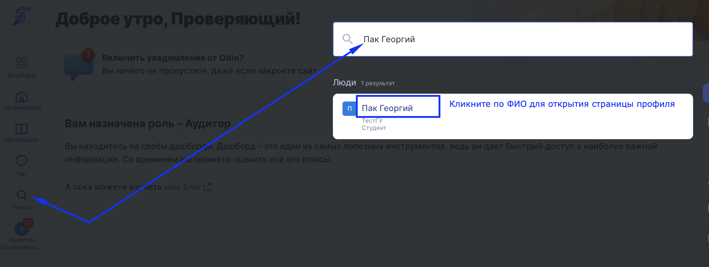
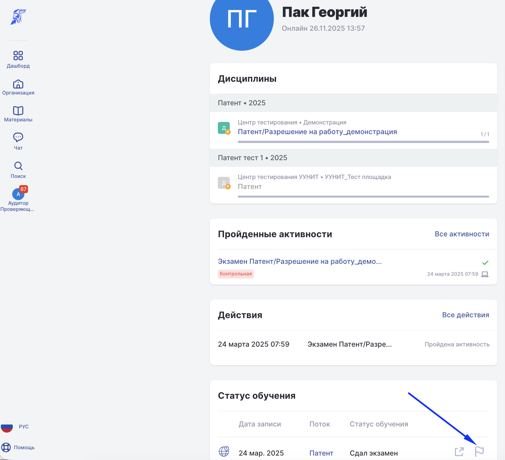
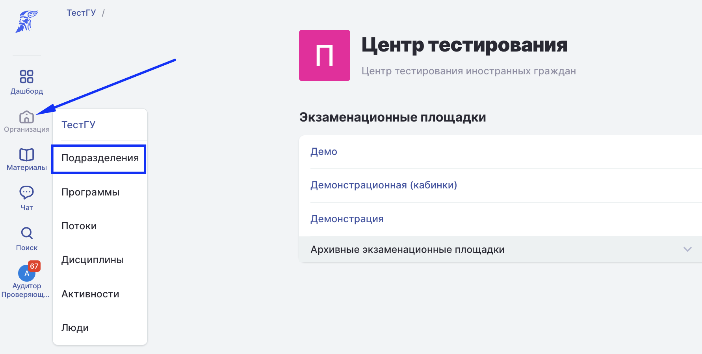
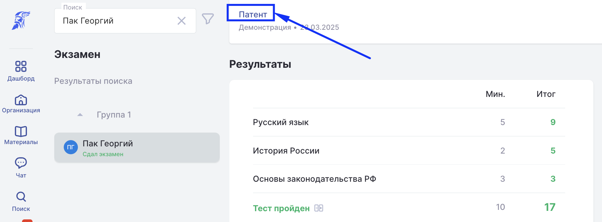
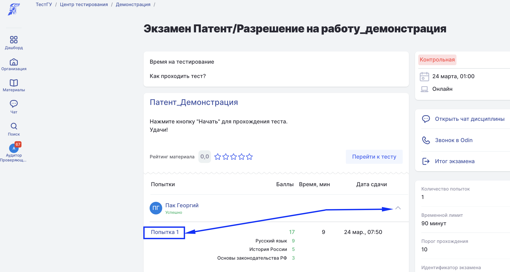

В  Odin сдающий проходит тестирование и сдаёт устную часть (для экзаменов по РВП и ВНЖ). \
Обе части экзамена фиксируются в системе и сохраняются видео.

### Как посмотреть результаты и видео сдающего экзамен?

[tabs]

[tab:Со страницы сдающего]

1. Введите в поиске фамилию/фамилию имя человека, чей экзамен необходимо проверить

{width=2362px height=892px}

2. Со страницы профиля сдающего нажать на флажок - итог экзамена

{width=1822px height=1660px}

[/tab]

[tab:Из списка экзаменов]

1. Откройте страницу центра тестирования

   {width=1782px height=900px}
2. Откройте страницу площадки, где требуется посмотреть экзамены

   {width=2170px height=816px}
3. В списке экзаменов, которые уже прошли, нажмите 3 точки и выберите пункт "Итог экзамена"

   *Экзамены, которые прошли по дате и проверены сотрудниками центра тестирования, будут отмечены архивными. Каждый из архивных экзаменов доступен для просмотра*

   {width=2182px height=1198px}
4. Выберите сдающего из списка и посмотрите его результаты и запись экзамена

   {width=1694px height=1150px}

[/tab]

[/tabs]

На странице итога экзамена можно посмотреть видео и результаты каждого из сдающих в экзамене.

{width=1684px height=1002px}

:::info

 Если необходимо посмотреть, какой ответ на какой из вопросов дал сдающий, то необходимо посмотреть его Попытку. \
Для этого на странице Итога экзамена

1. Откройте страницу экзамена

{width=1832px height=678px}

2. Разверните попытки и перейдите в нужную (у сдающего в рамках одного экзамена может быть несколько попыток, выданных по техническим причинам, например, выключили свет во время проведения. Информация о количестве попыток зафиксирована в Протоколе)

   {width=2352px height=1252px}

:::
